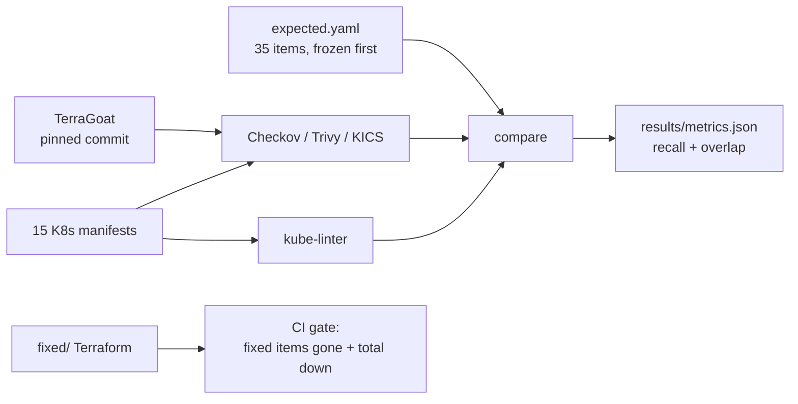

# iac-misconfig-hunter

How well do Checkov, Trivy, KICS and kube-linter find **35 known misconfigurations** in
deliberately vulnerable Terraform and Kubernetes code? This repository measures it, then fixes
the findings and enforces the fix in CI.

## Why

"I ran a scanner" is not a security result. The useful questions are: which scanner catches which
class of issue, what does each one miss, and does the fixed code actually stop being reported?
This repo answers those with a frozen ground truth and audit-friendly matching.

## Method



- **Ground truth:** `expected.yaml` lists 20 Terraform items and 15 Kubernetes items, each with
  file, resource and category. It was committed before the first scanner run.
- **Normalisation:** `mapping.yaml` maps each category to keywords. A finding counts only when it
  is on the expected file/resource and its title/message contains a keyword. Every match is
  written to `results/matches.csv` with the exact check, so the result can be audited.
- **Fixed set:** the AWS module is copied to `fixed/` and the 14 most severe findings are fixed.
  `scripts/gate.py` fails CI if any of those 14 is still reported or if the total findings did
  not go down.

## Results

See [`results/RESULTS.md`](results/RESULTS.md) and [`results/metrics.json`](results/metrics.json).

## Run

```bash
python -m venv .venv && . .venv/bin/activate
pip install -r requirements-dev.txt checkov==3.2.458
sudo apt install -y docker.io   # KICS runs as a container
bash scripts/scan_all.sh        # downloads TerraGoat, runs all four scanners
python scripts/gate.py
```

Or push: `.github/workflows/ci.yml` runs the same thing on Ubuntu with pinned tools.

## Limitations

- Keyword matching is a heuristic; the exact matches are in `matches.csv` and can be challenged.
- TerraGoat is a teaching target, not a production codebase.
- Finding counts are not directly comparable between scanners (different rule granularity);
  recall on the same 35 items is the comparable metric.
- Checkov's free JSON does not contain severity, so the gate is check-ID based, not "0 HIGH".
  This is stated instead of pretending a severity gate exists.

## Sources and licence

See [`SOURCES.md`](SOURCES.md). Code: MIT.

## Author

**Youssef Bouaouina** — [github.com/youssefbouaouina](https://github.com/youssefbouaouina) ·
[portfolio](https://youssefbouaouina.github.io/)
